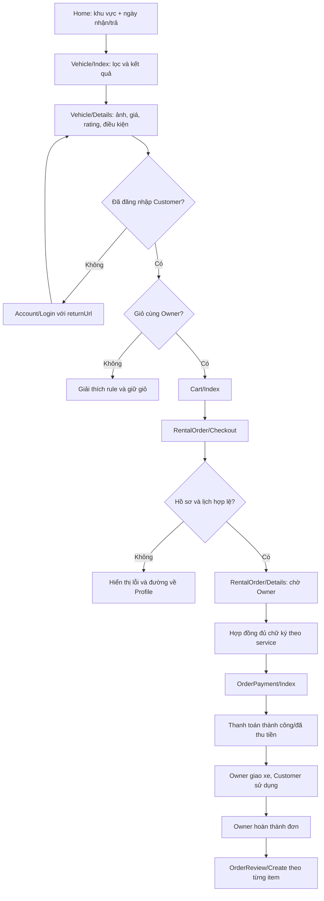
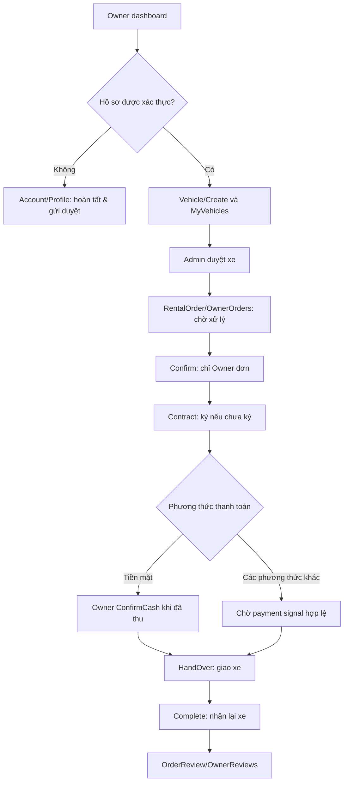
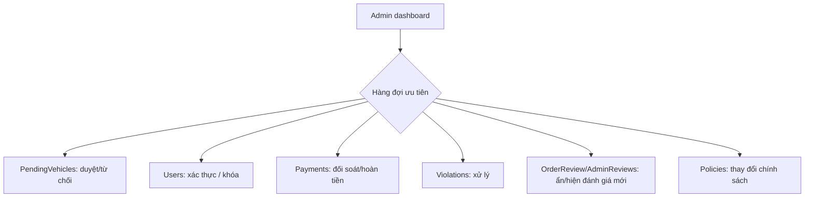

# GĐ4.0 — User journeys và các trạng thái ngoại lệ

Đây là bản đồ **thiết kế đích**, không phải khẳng định UI đã thực thi. Mỗi nút hành động khi triển khai phải nối vào controller/service hiện có và chỉ cho phép khi business guard cho phép.

## Journey 1 — Guest → Customer đặt đơn nhiều xe

**Cần kiểm tra cạnh**: thời gian thuê chuyển từ listing sang checkout mà không làm client quyết định giá; slot conflict; xe bị chờ duyệt/bảo trì; đổi Owner trong giỏ; hết hạn phiên; back/refresh checkout; nhiều xe cùng Owner; chủ xe từ chối; không đủ xác thực; login returnUrl; payment pending/failed/cancelled/expired; màn hình điện thoại QR.

**Mục tiêu:** người dùng thấy *bước hiện tại / ai đang xử lý / hành động tiếp theo*. Không hứa "xe còn trống" tuyệt đối nếu truy vấn không khóa tồn kho; service kiểm tra lại lúc tạo/xác nhận.

## Journey 2 — Owner: từ đăng xe đến hoàn thành

**Trạng thái hàng đợi:** `Chờ xác nhận` → `Chờ ký` → `Chờ thu tiền / chờ thanh toán` → `Chờ giao xe` → `Đang thuê / chờ nhận lại` → `Hoàn thành`. Đây là **nhóm UI**, không phải enum mới trong DB.

**Nguy cơ**: nhấn action sai thứ tự, double-submit, mở đơn không thuộc Owner, bảng lịch thiếu phản hồi khi trống, chồng ngày, hoàn tiền khi hủy.

## Journey 3 — Admin: xử lý các việc cần ưu tiên

Các action nguy cơ cao phải có xác nhận tương ứng và phản hồi sau POST; không lưu dữ liệu nhạy cảm vào localStorage hoặc URL. `Admin/IdentityDocument` và `Account/IdentityDocument` không được trở thành asset công khai sau khi đổi layout.

## Journey 4 — Luồng legacy được giữ nguyên

`Booking/Create → Booking/Details → Contract/Details → Payment (legacy) → Review/Create`; `Booking/Requests` cho Owner; `Booking/MyBookings` cho tài khoản đã đăng nhập. Đây không phải route ưu tiên quảng bá khi thiết kế mới nhưng **không được xóa**, vì dữ liệu và link cũ có thể tồn tại.

## Quy tắc điều hướng

- Trường hợp có `returnUrl` hợp lệ: giữ nguyên deep link; trường hợp không có: landing tương ứng vai trò (thực thi tại 4.1/4.4/4.5).
- Admin truy cập trang public vẫn được phép xem thông tin công khai; nhưng không hiển thị CTA của Customer.
- Không tự động redirect Owner/Admin ra khỏi public khi người dùng đang chủ động xem xe.
- Một giao dịch kết thúc phải có trạng thái kết thúc rõ: thanh toán thành công/thất bại, đặt đơn thành công, review thành công.
- Giỏ hàng chỉ chứa xe cùng Owner: giải thích tại vị trí quyết định, không bắt khách phát hiện qua lỗi cuối checkout.
- Ký hợp đồng, tiền mặt, hủy/hoàn tiền, báo cáo vi phạm: giữ đầy đủ guard và anti-forgery hiện có.
